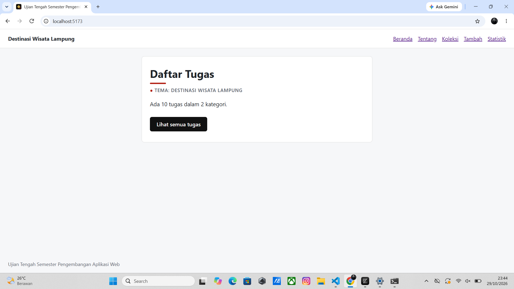

# Nama Aplikasi

Nama: Samuel Purba
NIM: 124140185
Kelas: RA
Tema: Destinasi Wisata Lampung
Deployment: https://s4mpu2.github.io/uts-paw/

## Fitur
- Halaman Koleksi= menampilkan data wisata yang ada di lampung lengkap dengan kabupaten. dari masing' tempat wisata dapat di klik untuk melihat detail berupa jam buka dan harga tiket.
- Halaman Tambah = laman form untuk menambah data wisata baru yang akan dikunjungi.
- Statistik: Digunakan sebagai Tabel menampilkan kategori wisata yang tersedia (alam,budaya).

## Menjalankan secara lokal

cd app
npm install
npm run dev

## Konsep React yang dipakai
- komponen: merupakan halaman dan bagian tampilan dibuat sebagai komponen React.
- Props: Data dikirim ke komponen lain, misalnya data destinasi ke kartu
- Hooks: useState mengelola input dan filter; useEffect untuk mengambil data.
- Context: membagikan data koleksi ke beberapa halaman
- React Router: untuk mengatur perpindahan halaman
- Rendering data: filter, dan reduce menampilkan, mencari dan menghitung destinasi.